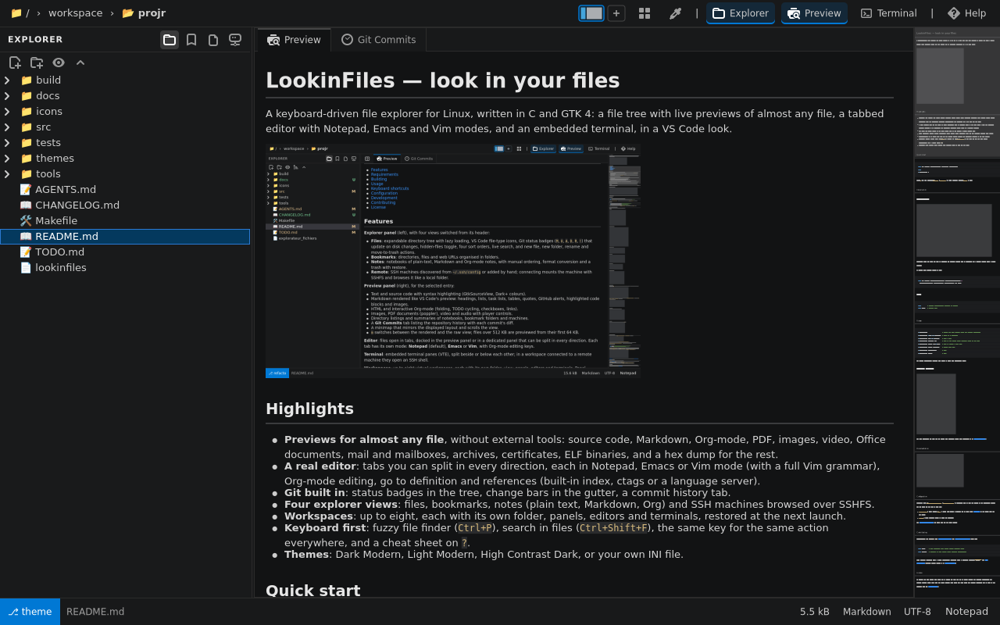

# File Explorer

A keyboard-driven file explorer for Linux, written in C with GTK 4: a file
tree with live previews, a multi-mode text editor (Notepad, Emacs, Vim),
notes, bookmarks, SSH remote machines, an embedded terminal and virtual
workspaces, in a VS Code Dark+ look.



## Contents

- [Features](#features)
- [Requirements](#requirements)
- [Building](#building)
- [Usage](#usage)
- [Keyboard shortcuts](#keyboard-shortcuts)
- [Configuration](#configuration)
- [Development](#development)
- [Contributing](#contributing)
- [License](#license)

## Features

**Explorer panel** (left), with four views switched from its header:

- **Files**: expandable directory tree with lazy loading, VS Code file-type
  icons, Git status badges (`M`, `U`, `A`, `D`, `R`, `!`) that update on disk
  changes, hidden-files toggle, four sort orders, live search, and new file,
  new folder, rename and move-to-trash actions.
- **Bookmarks**: directories, files and web URLs organised in folders.
- **Notes**: notebooks of plain-text, Markdown and Org-mode notes, with
  manual ordering, format conversion and a trash with restore.
- **Remote**: SSH machines discovered from `~/.ssh/config` or added by hand;
  connecting mounts the machine with SSHFS and browses it like a local folder.

**Preview panel** (right), for the selected entry:

- Text and source code with syntax highlighting (GtkSourceView, Dark+ colours).
- Markdown rendered like VS Code's preview: headings, lists, task lists
  (including in-progress `[/]` / `[-]` tasks), tables, quotes, GitHub alerts,
  highlighted code blocks and images.
- HTML and interactive Org-mode (folding, TODO cycling, checkboxes, links).
- Images, PDF documents (poppler), video and audio with player controls.
- Directory listings and summaries of notebooks, bookmark folders and machines.
- A **Git Commits** tab listing the repository history with each commit's diff.
- Git change bars in the text preview and the editor, as in VS Code: lines
  added (green), modified (blue) or deleted (red marker) since the last commit;
  the editor updates them while typing.
- A minimap that mirrors the displayed layout and scrolls the view.
- File types are detected from the content (an image or a `#!` script without
  extension, TypeScript `.ts` that is not a video); unknown binary files show a
  short notice instead of garbled text.
- `m` switches between the rendered and the raw view; files over 512 KB are
  previewed from their first 64 KB.

**Editor**: files open in tabs, docked in the preview panel or in a dedicated
panel that can be split in every direction. Each tab has its own mode:
**Notepad** (default), **Emacs** or **Vim**, with Org-mode editing keys.

**Terminal**: embedded terminal panes (VTE), split beside or below each other;
in a workspace connected to a remote machine they open an SSH shell.

**Workspaces**: up to eight virtual workspaces, each with its own folder, view,
panels, editors and terminals. Panel arrangements can be saved as named
layouts and applied from a list, including the default layout new workspaces
open with.

**Keyboard first**: Vim-style navigation everywhere, one shortcut per action
in every view, a built-in cheat sheet (`?`), and dialogs drawn inside the
window.

## Requirements

| Component | Package (Debian / Ubuntu) | Needed for |
|---|---|---|
| GTK 4.12 or newer | `libgtk-4-dev` | Required |
| C compiler, make, pkg-config | `build-essential pkg-config` | Required |
| VTE for GTK 4 | `libvte-2.91-gtk4-dev` | Embedded terminal (optional) |
| GtkSourceView 5 | `libgtksourceview-5-dev` | Syntax highlighting (optional) |
| poppler-glib | `libpoppler-glib-dev` | PDF preview (optional) |
| librsvg | `librsvg2-common` | Toolbar icons (present on any GTK desktop) |
| Git | `git` | Status badges and the Git Commits tab (at run time) |
| SSHFS | `sshfs` | Browsing remote machines (at run time) |

Optional libraries are detected by the Makefile: without them the application
still builds and shows a notice where the feature would be.

## Building

```bash
sudo apt install build-essential pkg-config libgtk-4-dev
sudo apt install libvte-2.91-gtk4-dev libgtksourceview-5-dev libpoppler-glib-dev  # optional
make
```

The binary `explorateur_fichiers` is created in the project directory (objects
in `build/`). `make clean` removes both.

## Usage

```bash
./explorateur_fichiers                     # current directory, 1000×600 window
./explorateur_fichiers /path/to/directory  # start in another directory
./explorateur_fichiers --size 1920x1080    # window size (also -s)
./explorateur_fichiers --fullscreen        # start in fullscreen (also -f)
```

Press `?` at any time for the list of shortcuts, `Alt+Left` / `Alt+Right` to
move between panels, and `Ctrl+Q` to quit.

## Keyboard shortcuts

The same list is available inside the application with `?`.

### Global

| Key | Action |
|---|---|
| `Ctrl+Q` | Quit |
| `?` | Show / hide the shortcut cheat sheet |
| `f` | Toggle fullscreen (`Ctrl+F` keeps its paging role) |
| `Alt+Left` / `Alt+Right` | Move the focus between the open panels |
| `Alt+1` … `Alt+8` | Switch virtual workspace (or click the top-bar workspace map) |
| `Alt++` / `Alt+-` | Add a workspace with the default layout / close the current one |
| `Alt+L` | Workspace layouts: apply a saved layout, save the current panels under a name (`Default` for new workspaces), delete one or reset the default |
| `Ctrl+T` | Open a terminal pane beside the running ones (exit the shell to close it) |
| `Ctrl+Shift+T` | Open a terminal pane below the running ones |
| `Ctrl+Shift+L` | Stack the terminal under the viewer, or put it back beside it |
| `Ctrl+A` | Switch between the files and bookmarks views |
| `Ctrl+U` | Switch between the files and notes views |
| `Ctrl+Shift+R` | Switch between the files and remote machines views |

### Explorer panel

| Key | Action |
|---|---|
| `j` / `k`, `Down` / `Up` | Next / previous visible entry |
| `gg` / `G`, `Home` / `End` | First / last entry |
| `Ctrl+F` / `Ctrl+B`, `Page Down` / `Page Up` | One page down / up |
| `zz` / `zt` / `zb` | Scroll the selected entry to the center / top / bottom |
| `Space` | Expand / collapse the selected directory |
| `l` / `Right` | Expand the selected directory, or step into its first child |
| `h` / `Left` | Collapse the selected directory, or jump to its parent |
| `Enter` / double click | Expand a directory, open a file in the editor, open a bookmark |
| `Ctrl+Enter` | Enter the selected directory as the new root |
| `Backspace` | Parent directory (or back to the files view) |
| `/`, then `n` / `N` | Search entries by name, next / previous match |
| `a` / `Shift+A` | New file / new folder in the selected directory |
| `F2` / `r` / `e` | Rename the selected file or folder |
| `d` / `Delete` | Move the selected file or folder to the trash (asks first) |
| `i` / `I` | Toggle hidden files |
| `o` | Cycle the sort: name, date, size, extension |
| `Ctrl+D` | Bookmark the selected entry or the current directory |
| `m` | Toggle the rendered / raw preview of the selected file |
| Right click | Context menu (bookmarks, notes and remote views) |

**Bookmarks view**

| Key | Action |
|---|---|
| `Enter` / `l` | Open the bookmark (directory, file or URL) / expand the folder |
| `a` / `Shift+A` | Add a bookmark / a folder (inside the selected folder) |
| `F2` / `r` / `e` | Edit name, location and folder |
| `d` / `Delete` | Delete the selected bookmark or folder |
| `Shift+K` / `Shift+J` | Move the selected item up / down |
| `o` | Cycle the sort: A–Z / Z–A |

**Notes view**

| Key | Action |
|---|---|
| `a` / `Shift+A` | New note (Plain Text, Rich Format or Org-mode) / new notebook |
| `F2` / `r` / `e` | Edit the note (title and format) or notebook (name and icon) |
| `i` | Change the notebook icon |
| `m` | Move the note to another notebook |
| `d` / `Delete` | Move the note to the trash, or delete the notebook |
| `Shift+R` | Restore the note from the trash to its notebook |
| `Shift+K` / `Shift+J` | Move the selected note or notebook up / down |
| `o` | Cycle the sort: manual / A–Z / Z–A |

**Remote view**

| Key | Action |
|---|---|
| `Enter` / `c` | Connect the machine (SSHFS) and browse it in the explorer |
| `t` | Open an SSH terminal to the machine |
| `a` | Add a machine |
| `F2` / `r` / `e` | Edit the selected machine |
| `d` / `Delete` | Delete the selected machine |
| `F5` | Re-scan `~/.ssh/config` |

### Preview panel

| Key | Action |
|---|---|
| `j` / `k` | Scroll one line down / up |
| `Ctrl+F` / `Ctrl+B` | Scroll one page down / up |
| `gg` / `G` | Start / end of the file |
| `/`, then `n` / `N` | Search in the content, next / previous match |
| `e` | Open the file in the editor (text files) |
| `m` | Rendered / raw view (Markdown, HTML, Org), fitted / 1:1 (images), pages / text (PDF), player / file details (video, audio) |
| `Space` / `p` | Play / pause the video or audio |
| `Tab` / `Shift+Tab` | Org-mode: fold the heading / cycle the global visibility |
| `t` | Org-mode: cycle the TODO keyword (`TODO` → `NEXT` → `DONE` → none) |
| `Space` / `Enter` | Org-mode: toggle the checkbox `[ ]` ↔ `[X]` |
| Click | Org-mode: fold a heading, cycle a TODO, toggle a checkbox, open a link |
| `Esc` | Close the search bar |

### Editor tabs

Opening a file (`Enter` or double click in the explorer) adds a tab next to the
**Preview** tab. A bullet in the tab title marks unsaved changes.

| Key | Action |
|---|---|
| `Ctrl+S` | Save the file |
| `Ctrl+W` | Close the tab (asks first when there are unsaved changes) |
| `Ctrl+E` | Move the tab to the dedicated editor panel, or dock it back |
| `Ctrl+Alt+Arrows` / `Ctrl+Alt+H J K L` | Move / split the tab left, down, up or right |
| `Ctrl+R` / `F2` | Rename the current text buffer |
| `Tab` / `Shift+Tab` | Org-mode: fold the heading / cycle the global visibility |
| `Shift+Right` / `Shift+Left` | Org-mode: cycle the TODO keyword |
| `Alt+Enter` | Org-mode: new heading at the current level |
| `Ctrl+Enter` / `Ctrl+Space` | Org-mode: toggle the checkbox and update the progress cookie |
| Right click on the tab | Change the mode, move, split or close the tab |

The editor mode is changed from the status bar button, the tab menu,
`:set mode=vim|emacs|notepad` in Vim mode or `M-x vim-mode` / `emacs-mode` /
`notepad-mode` in Emacs mode.

<details>
<summary><strong>Notepad mode</strong> (default)</summary>

| Operation | Keys |
|---|---|
| Edit | Typing, `Ctrl+X` / `Ctrl+C` / `Ctrl+V`, `Ctrl+A` |
| Move | Arrows, `Ctrl+Left` / `Ctrl+Right`, `Home` / `End`, `Ctrl+Home` / `Ctrl+End`, `Page Up` / `Page Down`, go to line `Ctrl+G` |
| Find and replace | `Ctrl+F`, `Ctrl+H`, `F3` / `Shift+F3` |
| Format | Align left / center / right / justify `Ctrl+L` / `E` / `R` / `J`, indent `Tab`, unindent `Shift+Tab` |
| Undo and redo | `Ctrl+Z`, `Ctrl+Y` / `Ctrl+Shift+Z` |
| Save | `Ctrl+S`, Save As `Ctrl+Shift+S` |

</details>

<details>
<summary><strong>Emacs mode</strong></summary>

GNU Emacs mode line and minibuffer (echo area).

| Operation | Keys |
|---|---|
| Edit | `C-d` delete char, `M-d` / `M-DEL` kill word, `C-k` kill line, `C-SPC` / `C-@` set mark, `C-g` cancel, `C-w` kill region, `M-w` copy, `C-y` yank |
| Move | `C-f` / `C-b`, `C-n` / `C-p`, `M-f` / `M-b`, `C-a` / `C-e`, `M-<` / `M->`, `C-v` / `M-v`, `C-l` recenter, `M-g g` go to line |
| Find and replace | `C-s` / `C-r` incremental search, `M-%` query replace |
| Format | `M-q` fill paragraph (72 columns), `M-u` / `M-l` / `M-c` case, `M-x set-justification-left` / `center` / `right` / `full` |
| Undo and redo | `C-/`, `C-_`, `C-x u` / `C-Shift-_`, `M-_` |
| Save | `C-x C-s`, write file (Save As) `C-x C-w` |
| Commands | `M-x` (`goto-line`, `query-replace`, `fill-paragraph`, `save-buffer`, `write-file`, `undo`, `redo`, mode switches) |

</details>

<details>
<summary><strong>Vim mode</strong></summary>

Vim status line with mode badge, ruler and command line (`:`, `/`, `?`).

| Operation | Keys |
|---|---|
| Insert | `i` / `I` / `a` / `A` / `o` / `O`, `s` / `S` / `cc`, `C` / `c$`, `cw`; back to Normal `Esc` / `Ctrl+[`; in Insert `Ctrl+W` / `Ctrl+U` |
| Delete and change | `x` / `X`, `dd`, `dw`, `d$` / `D`, `d0`, `dG`, `r<char>`, `~` |
| Visual | `v` / `V`, then `d` / `x` cut, `y` yank, `c` change, `>` / `<` indent, `u` / `U` case |
| Yank and put | `yy` / `Y`, `yw`, `p` / `P` |
| Move | `h` `j` `k` `l`, `w` / `b` / `e`, `0` / `^` / `$`, `gg` / `G`, `[count]G`, `:<line>`, `Ctrl+F` / `Ctrl+B`, `Ctrl+D` / `Ctrl+U`, `zz` |
| Find and replace | `/pattern`, `?pattern`, `n` / `N`, `*`, `:%s/old/new/g`, `:s/old/new/g` |
| Format | `==`, `>>` / `<<`, `gq` (80 columns), `:center [width]`, `:right [width]`, `:left` |
| Undo and redo | `u`, `Ctrl+R` |
| Save and quit | `:w`, `:w <file>`, `:saveas <file>`, `ZZ` / `:wq` / `:x`, `:q`, `:q!` |

</details>

## Configuration

Settings and data are kept in `~/.config/explorateur_fichiers/`
(`$XDG_CONFIG_HOME` is honoured):

| Path | Content |
|---|---|
| `bookmarks.xml` | Bookmarks and bookmark folders |
| `notes/` | Notebooks (one directory each), notes, `notes.xml` and the `.trash/` |
| `remotes.xml` | Remote machines added by hand (`~/.ssh/config` hosts are read directly) |
| `layouts.ini` | Saved workspace layouts and the default layout of new workspaces |

Remote machines are mounted under `~/.cache/explorateur_fichiers/remotes/`.

Toolbar icons are bundled in the binary, so they look the same with any icon
theme. If buttons show no icon, `EXPLORATEUR_DEBUG_ICONS=1 ./explorateur_fichiers`
prints which icon file each button uses.

## Development

```bash
make check     # build with zero warnings, unit tests, module layering rules
make test      # unit tests only (GLib, no display needed)
make ui-test   # headless UI test (needs xvfb, xdotool and imagemagick)
```

`make ui-test` runs the application on a virtual X display, drives it with the
keyboard and mouse, and saves a screenshot of every step in `build/ui/shots/`.
It fails when the window does not open, a dialog opens a separate window, GTK
logs a warning, or `Ctrl+Q` does not quit cleanly. `UI_BASELINE=<directory>`
compares the screenshots with those of another run.

The code lives in `src/`, one module per feature, in layers checked by
`make check` (`tools/check_layers.sh`):

| Layer | Modules |
|---|---|
| Foundation (no widgets, unit-tested) | `file_types`, `git_utils`, `line_diff`, `explorer_row`, `layout_store` |
| Shared helpers | `diff_gutter`, `app_events`, `panels`, `fs_watch`, `remote_store`, `preview_summary`, `text_style`, `theme`, `icons`, `dialog`, `image_utils`, `explorer_tree`, `tree_nav`, `markdown`, `html`, `minimap` |
| Features | `file_list`, `file_actions`, `bookmarks`, `notes`, `remote`, `viewer`, `orgmode`, `pdf`, `video`, `audio`, `git_tab`, `editor`, `editor_modes` (+ `editor_notepad`, `editor_emacs`, `editor_vim`, `editor_org`), `terminal`, `search` |
| Window | `topbar`, `status_bar`, `sidebar`, `help`, `workspace`, `layouts`, `ui`, `main` |

[AGENTS.md](AGENTS.md) describes the architecture, the conventions and the
rules in detail. Release history is in [CHANGELOG.md](CHANGELOG.md).

## Contributing

Contributions are welcome. Before opening a pull request:

1. Read [AGENTS.md](AGENTS.md): module layers, UI conventions (same key for
   the same action in every view, no separate windows, no deprecated GTK API).
2. Run `make check` and, for interface changes, `make ui-test`.
3. Keep commits focused, with a short imperative subject
   (e.g. `Add Ctrl+F paging in the explorer`).
4. Update this README and the in-app cheat sheet (`src/help.c`) together
   when a shortcut changes.

## License

No license has been chosen for this project yet; until one is added, the
code may not be reused without the authors' permission. The bundled toolbar
icons come from the GNOME Adwaita icon theme and keep their own license
(CC-BY-SA 3.0 or LGPL 3, and CC-BY-SA 4.0; see [icons/COPYING](icons/COPYING)).
